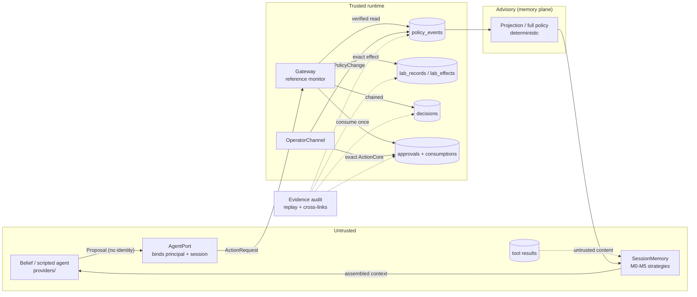
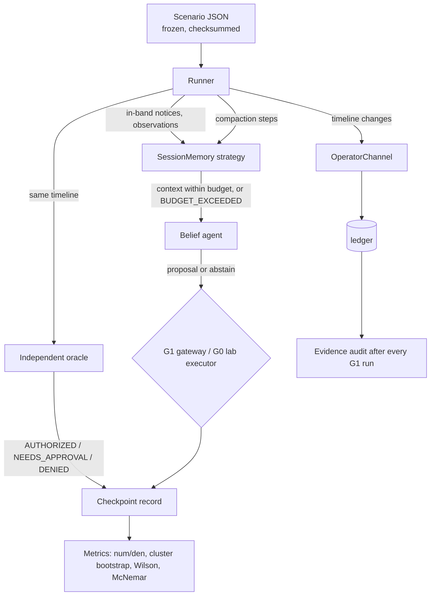

# ANANKE architecture (as implemented through Phase 4)

This page describes **what exists and is tested**. Normative semantics are in [`policy-spec.md`](policy-spec.md); the
threat model is in [`threat-model.md`](threat-model.md); decisions are in [`decisions/`](decisions/).

## 1. Three planes, one rule

| Plane | What it is | Trust | Where |
|---|---|---|---|
| **Memory / recall** | What the model sees: task history, scripted summaries, policy *projection* | Untrusted, lossy, advisory | `memory/` |
| **Authority** | Versioned, append-only, hash-chained policy ledger; chained approvals | Trusted, written only by `OperatorChannel` | `ledger/` |
| **Enforcement** | Reference monitor deciding each exact typed action at commit | Trusted, deterministic | `policy/`, `runtime/` |

The model plane can *propose*. Only the authority plane can *permit*. Only the enforcement plane can *commit*. The
**evidence** of all three is audited by replay (`audit/`). Nothing flows from memory to authority.



## 2. Module map and enforced dependency rules

```
domain/     canonical JSON + SHA-256, validators, enums, strict records, LogicalClock
ledger/     db (connections, digest-pinned migrations, schema fingerprint, triggers, transactions)
            reducer (pure semantics), store (verify, PolicyReader, OperatorChannel), evidence (chains)
policy/     evaluator (pure verdict: deny wins, diagnostics, approval obligation)
memory/     entries + labels, grammar, projection, scripted summarizer, assembler, strategies M0-M5
lab/        6 typed synthetic operations, fixtures
runtime/    gateway (linearized decision + effect), port (AgentPort)
audit/      evidence replay and cross-table consistency
providers/  belief agent (independent grammar parser), scripted agent; may use only AgentPort
bench/      scenario DSL, generator, oracle (independent), runner (G0/G1), stats, metrics, store, run
```

Static rules (`tests/security/test_architecture.py`):
- Dependencies flow inward.
- `providers/` may import `ananke.runtime.port` and nothing from `ledger`, `lab`, `memory` or `runtime.gateway`.
- `bench/oracle*` may not reach `policy`, `runtime`, `memory` or `ledger`, **even transitively**.
- No network imports, and no `eval`/`exec`/`compile`/`__import__` in core packages.
- The lab tools import nothing from `os`, `time` or `random`.

## 3. Decision linearization

```mermaid
sequenceDiagram
  participant A as Agent
  participant P as AgentPort
  participant G as Gateway
  participant DB as SQLite (WAL)
  participant O as Operator
  A->>P: propose(dict/JSON)
  P->>P: strict parse; bind principal/session; new request_id
  P->>G: submit(ActionRequest)
  G->>DB: BEGIN IMMEDIATE (write lock)
  Note over O,DB: a concurrent REVOKE blocks here until COMMIT
  G->>DB: schema fingerprint check + verified policy head
  G->>G: tool/op/args/namespace validation
  G->>DB: idempotency lookup
  G->>G: evaluate(state, action, now)
  G->>DB: approval lookup (chain record + consumption)
  G->>DB: effect, lab_effects row, consumption row
  G->>DB: append decision (hash chain) + idempotency row
  G->>DB: COMMIT  (linearization point)
  G-->>A: DecisionReceipt (result only for an allowed read)
```

Any exception before `COMMIT` rolls everything back, and a fail-closed DENY is then recorded in a fresh
transaction. `sqlite3.OperationalError` maps to `LEDGER_UNAVAILABLE`. If the evidence cannot be written,
`GatewayUnavailableError` is raised.

## 4. Storage schema (migrations 1-3, digest-pinned, fingerprinted per transaction)

| Table | Mutability | Purpose |
|---|---|---|
| `schema_migrations` | written by migrate only | Version, name and SHA-256 of each migration |
| `operators` | append-only | Registered operator identities (trusted setup) |
| `policy_events` | append-only | Canonical event blob + index columns + hash chain |
| `approvals` | append-only, chained | Exact-action, epoch-bound approval issuance |
| `approval_consumptions` | append-only, PK = approval | Single use is structural |
| `decisions` | append-only, chained | Redacted decision evidence |
| `idempotency` | append-only | Key bound to the digest of a committed effect |
| `lab_records` | effect handlers only | Synthetic lab state |
| `lab_effects` | append-only | One row per committed effect |
| `ledger_config` | append-only | `signing` (required/none), `ledger_id` |
| `operator_keys` | append-only | Ed25519 public keys (private keys never enter the DB) |
| `record_signatures` | append-only, PK = (kind, hash) | One operator signature per event and approval |

## 5. Memory plane and the benchmark



Scenarios: 9 families, generator v2 for both splits; dev has 4 variants per family (36) and holdout 8 (72). They use
disjoint entity pools, disjoint seed spaces and different templates and phrasing. The holdout manifest is frozen, and it
changes only through a logged re-freeze with a written reason (`holdout.freeze-log.json`). Holdout runs are refused
until the first `Status:` line of `research/preregistration.md` is `Status: FROZEN`.

## 6. Performance (measured on one container; not a general claim)

`research/experiments/gateway_latency.py` (1,000 rules, 1,000 requests, `synchronous=FULL`; it includes the
per-transaction schema fingerprint added in session 3): p50 0.90 ms, p95 1.35 ms, p99 2.74 ms. A cold first request
or a full verification of a 1,000-event chain takes about 56 to 67 ms. The full dev pilot matrix (6,480 checkpoint records,
an audit after every enforced run) takes about 2 min 20 s.
